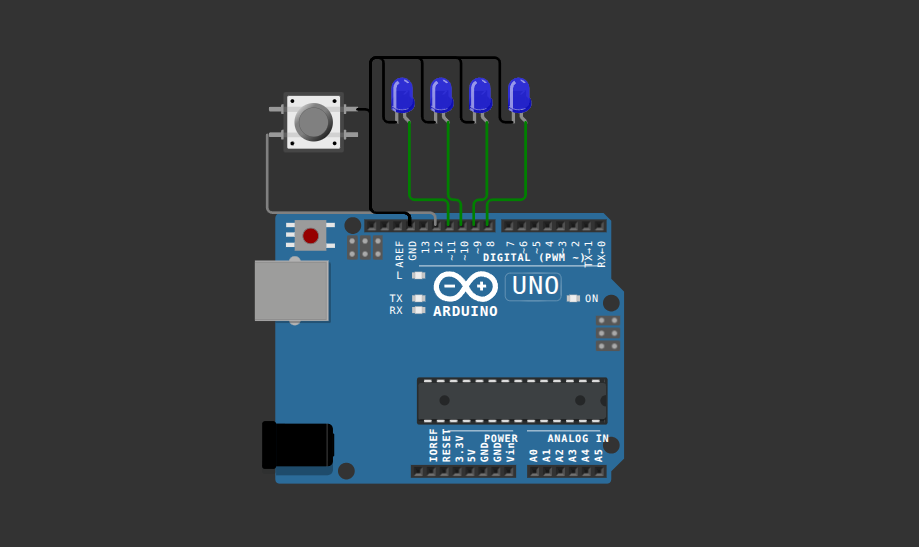
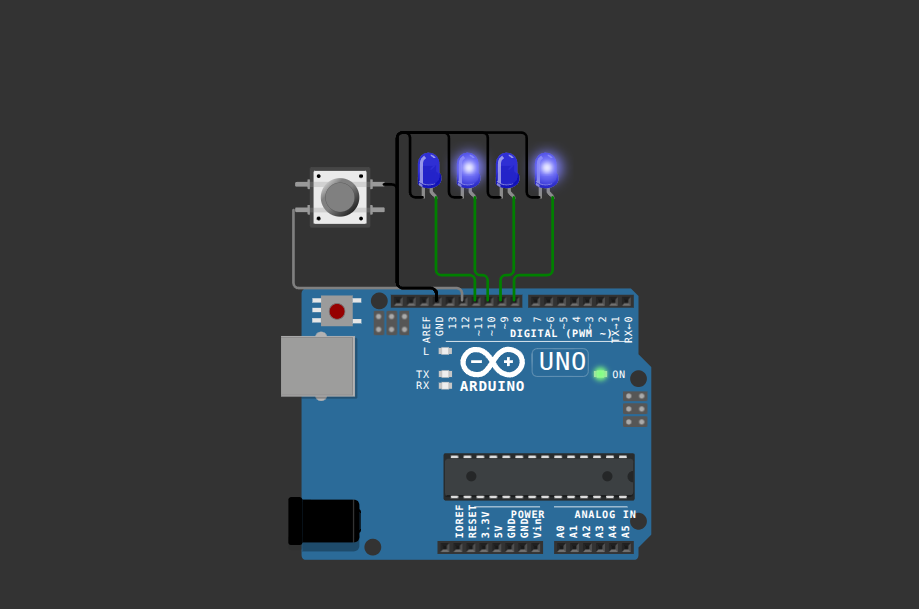
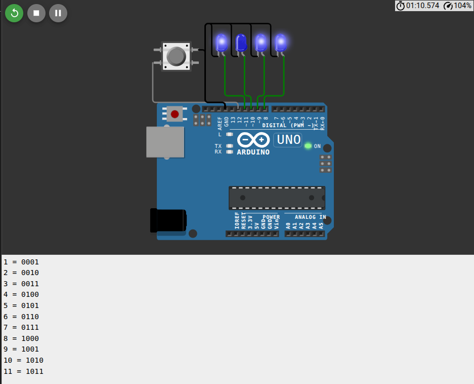

# Simulation Results — Challenge #03

## Simulation Details

- Platform: Wokwi
- Board: Arduino Uno
- Project: [4-Bit Binary Counter — Wokwi](https://wokwi.com/projects/480939459201463297)

## Circuit Configuration

- Four LEDs connected to D8, D9, D10, and D11.
- One pushbutton connected between D12 and GND.
- The button uses the microcontroller's internal pull-up resistor, enabled in firmware.

## Observed Behaviour

The simulation was run successfully. Each button press advanced the counter by one. The four LEDs displayed the corresponding binary value. The Serial Monitor displayed both decimal and 4-bit binary values.

The counter sequence completed the full range from 0 through 15 and then rolled over to 0.

## Evidence Files
| Description | Image |
|---|---|
| **Complete circuit** |  |
| **LEDs showing a counter value** |  |
| **Decimal and binary Serial Monitor output** | |

## Result

**Simulation status: PASS**

This result records the successful simulation reported for this project. It does not claim a separate physical-hardware test.
